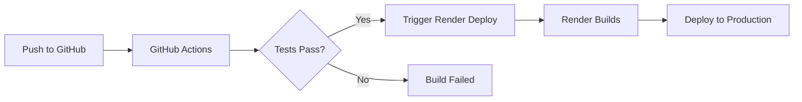

# Nexachron Deployment Guide for Render

## 🚀 Render CI/CD Setup

### Prerequisites
1. Render account (https://render.com)
2. GitHub repository connected to Render
3. Environment variables configured

### 📋 Environment Variables

#### Backend (nexachron-api)
- `NODE_VERSION`: 20.18.0
- `PORT`: 3001
- `DATABASE_URL`: Your database connection string
- `NODE_ENV`: production
- `FRONTEND_URL`: https://nexachron-web.onrender.com (optional)

#### Frontend (nexachron-web)
- `NODE_VERSION`: 20.18.0
- `PORT`: 3000
- `NEXT_PUBLIC_API_URL`: https://nexachron-api.onrender.com
- `NODE_ENV`: production

### 🔧 Setup Steps

#### 1. Create Services on Render

1. Go to Render Dashboard
2. Click "New +" → "Web Service"
3. Connect your GitHub repository
4. Create two services:
   - `nexachron-api` for backend
   - `nexachron-web` for frontend

#### 2. Configure Services

Both services should use the configuration from `render.yaml` file automatically.

#### 3. Set Environment Variables

For each service, go to "Environment" tab and add the required variables listed above.

#### 4. GitHub Secrets Setup (Optional for automated deployments)

Add these secrets to your GitHub repository:
- `RENDER_API_KEY`: Your Render API key (from Account Settings)
- `RENDER_API_SERVICE_ID`: Service ID for backend
- `RENDER_WEB_SERVICE_ID`: Service ID for frontend

Or use Deploy Hooks:
- `API_DEPLOY_HOOK`: Backend deploy hook URL
- `WEB_DEPLOY_HOOK`: Frontend deploy hook URL

### 📦 Deployment Process

#### Automatic Deployment
- Push to `main` branch triggers automatic deployment
- GitHub Actions runs tests and quality checks
- If all checks pass, deployment is triggered

#### Manual Deployment
1. Go to Render Dashboard
2. Select your service
3. Click "Manual Deploy" → "Deploy latest commit"

### 🔍 Monitoring

#### Health Checks
- Backend: `https://nexachron-api.onrender.com/health`
- Frontend: `https://nexachron-web.onrender.com/`

#### Logs
Access logs from Render Dashboard → Select Service → "Logs" tab

### 🐛 Troubleshooting

#### Frontend not starting
1. Check if Next.js build is successful
2. Verify `NODE_VERSION` is set correctly
3. Check if `NEXT_PUBLIC_API_URL` is configured

#### Backend not responding
1. Verify `DATABASE_URL` is set correctly
2. Check health endpoint: `/health`
3. Review logs for connection errors

#### Build failures
1. Ensure `pnpm` version matches: 10.17.0
2. Check Node.js version: 20.x
3. Verify all dependencies are installed

### 📝 Notes

- Free tier services sleep after 15 minutes of inactivity
- First request after sleep may take 30-60 seconds
- For production, consider upgrading to paid plans

### 🔄 CI/CD Workflow

### 📞 Support

For issues with:
- Render: https://render.com/docs
- Next.js: https://nextjs.org/docs
- NestJS: https://docs.nestjs.com