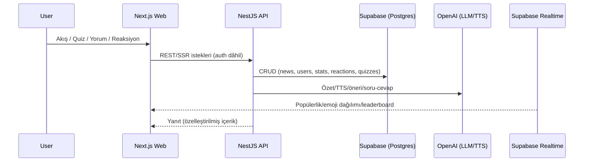

<div align="center" style="display:flex;align-items:center;justify-content:center;gap:14px;flex-wrap:wrap">


# Nexachron

**Gamified News Platform** – AI destekli içerik kürasyonu, quiz sistemleri ve sosyal etkileşimlerle haber deneyimini oyunlaştıran modern platform.

[](https://nextjs.org)
[](https://nestjs.com)
[](https://flutter.dev)
[](https://supabase.com)
[](https://platform.openai.com)
[](https://render.com)

</div>

---

## 📖 Proje Hakkında

**Nexachron**, haberi **okuma → yaşa → oyna → paylaş** döngüsüne taşıyarak (özet/TTS, reels akışı, quiz ve XP sistemi, kart koleksiyonu, duygu ve konum temelli keşif) genç kullanıcılar için hızlı, kişisel ve etkileşimli bir deneyim sunar.

---

## ✨ Temel Özellikler

### 🎮 Oyunlaştırma
- **XP & Rütbe**: Okuma, quiz, yorum gibi eylemlerle XP; rütbelere göre görünürlük.
- **Streak**: Günlük geri dönüş bonusları ve rozetler.
- **Kart Koleksiyonu**: Common/Rare/Legendary, ör. %75/%22/%3 droprate.
- **Liderlik Tablosu**: Haftalık/aylık rekabet.

### 📰 Akıllı Haber Deneyimi
- **Mod Bazlı Akış**: Mutlu, Hızlı Gündem, Dünya Turu, Sürpriz vb.
- **AI Özet + TTS**: 2–3 cümlede hızlı özet, tek tuşla sesli oynatma.
- **Gerçek Zamanlı**: Popüler haberler, trendler, anlık akış.

### 💬 Sosyal & Topluluk
- **Yorumlar**: Yüksek rütbeli kullanıcı yorumları üstte.
- **Emoji Tepkileri**: Canlı **duygu haritası** ve dağılım grafiği.
- **Konu Takip & Bildirim**: Push bildirim; Bildirim Merkezi.

### 🗺️ Keşif
- **Harita Bazlı Haberler**: İl/ilçe filtresi, ısı haritası, “Türkiye Turisti” rozeti.

### 🧠 İnteraktif AI
- **Soru-Cevap**: Haber altından sor, 2–4 cümle yanıt; her soru küçük XP.

### 🎬 Medya
- **Reels**: Dikey, autoplay kısa klipler; TTS + görsel + metin birleştirme prototipi.
- **Podcast/TTS**: Haber seslendirmeleri, playlist’ler.

---

## 🏁 Hackathon Bağlamı (MVP)

- **Sprint 1 (0–10 gün)**: Günlük bülten (özet+TTS), dikey akış, mini-quiz, XP/streak, temel auth.  
- **Sprint 2 (10–20 gün)**: Konu Takip, Bildirim Merkezi, duygu haritası, ilk leaderboard.  
- **Sprint 3 (20–27 gün)**: Kart koleksiyonu, harita keşif, tahmin oyunu, UI iyileştirmeleri, final demo.  
- **KPI**: Ortalama oturum ≥3 kart, quiz tamamlama ≥%40, günlük streak ≥%25.

---

## 🧱 Mimari Genel Bakış



---

## 📂 Monorepo Yapısı

```
nexachron/
├── apps/
│   ├── web/              # Next.js 15 (Port: 3000)
│   ├── api/              # NestJS 11  (Port: 4000)
│   └── mobile/           # Flutter
├── packages/
│   └── shared-types/     # Ortak TS tipleri
├── docs/                 # DB, DEPLOYMENT, TEAM_GUIDE, LOCAL_DEVELOPMENT
├── scripts/              # check-deploy.sh, test-production.sh, reels-setup
└── .github/workflows/    # CI/CD
```

> Dosya yapısı ve yetenekler, proje hedefleri ve must-have ihtiyaçlara göre şekillendirildi.

---

## 🛠️ Teknoloji Yığını

**Backend (NestJS 11)**: Prisma, Supabase (PostgreSQL), Supabase Auth (JWT), OpenAI API (GPT & TTS), Cheerio, RSS Parser, Pino, Schedule (Cron), Axios.  
**Frontend (Next.js 15)**: Tailwind CSS, TanStack Query, Supabase Auth Helpers, next-intl, Recharts, Lucide, React Simple Maps, TypeScript.  
**Mobile (Flutter)**: Riverpod, Go Router, Supabase Flutter, Flutter TTS, Local Notifications, Cached Network Image, Flutter Animate, Vibration.  
**Infra/DevOps**: Render (web/api), Supabase Cloud, Supabase Storage, PNPM, Turborepo, GitHub Actions, Monitoring via Render.

---

## ⚙️ Kurulum (Hızlı Başlangıç)

```bash
# 1) Klonla
git clone <repository-url>
cd nexachron

# 2) Bağımlılıkları yükle
pnpm install

# 3) .env dosyaları
cp apps/api/.env.example apps/api/.env
cp apps/web/.env.local.example apps/web/.env.local

# 4) Tüm servisleri başlat
pnpm dev
```

**Portlar**  
- Web: http://localhost:3000  
- API: http://localhost:4000  
- DB/Storage/Auth: Supabase Cloud

**Tekil servis**
```bash
pnpm dev:api     # backend
pnpm dev:web     # frontend
pnpm dev:mobile  # flutter
```

---

## 🔑 Environment Örnekleri

**Backend (`apps/api/.env`)**
```env
SUPABASE_URL=...
SUPABASE_ANON_KEY=...
SUPABASE_SERVICE_ROLE_KEY=...

OPENAI_API_KEY=...

AZURE_SPEECH_KEY=...
AZURE_SPEECH_REGION=...

NODE_ENV=development
PORT=4000
FRONTEND_URL=http://localhost:3000
```

**Frontend (`apps/web/.env.local`)**
```env
NEXT_PUBLIC_API_URL=http://localhost:4000
NEXT_PUBLIC_SUPABASE_URL=...
NEXT_PUBLIC_SUPABASE_ANON_KEY=...
```

**Mobile (dart-define)**
```bash
flutter run \
  --dart-define=SUPABASE_URL=... \
  --dart-define=SUPABASE_ANON_KEY=... \
  --dart-define=API_URL=http://localhost:4000
```

---

## 🔌 API Endpoint’leri (Özet)

```http
GET  /api/news                       # Liste
GET  /api/news/popular               # Popüler
GET  /api/news/mode/{mode}           # Mutlu/Top/World/Surprise...
GET  /api/news/category/{cat}        # Kategori
GET  /api/news/search?q=...          # Arama
GET  /api/news/{id}                  # Detay
POST /api/news/{id}/comment          # Yorum
POST /api/news/{id}/reaction         # Emoji
POST /api/news/{id}/bookmark         # Yer imi

GET  /api/users/profile              # Profil
PUT  /api/users/profile              # Profil güncelle
GET  /api/users/stats                # XP/streak/rütbe
GET  /api/users/leaderboard          # Leaderboard

GET  /api/games                      # Oyun listesi
POST /api/games/quiz                 # Quiz başlat
POST /api/games/quiz/{id}/answer     # Cevap
GET  /api/games/leaderboard          # Oyun leaderboard
GET  /api/games/cards                # Kart koleksiyonu

GET  /api/reels                      # Reels listesi
POST /api/reels/generate             # Reel oluştur (prototip)
POST /api/reels/{id}/like            # Beğeni

POST /api/tts/generate               # TTS oluştur
GET  /api/tts/{id}                   # TTS detayı

POST /api/v1/user-data/events        # Event tracking
```

---

## 📊 Veritabanı (Ana Tablolar)

`users, user_stats (rankLevel, xp, streak), news, news_media, categories, comments, reactions, bookmarks, games, game_results, cards, user_cards, quizzes, user_quizzes, predictions, reels, podcasts, tts_audio, user_events, analytics`

---

## 🧪 Test & Kalite

```bash
pnpm test             # tüm testler
pnpm --filter api test:cov
pnpm --filter web test
pnpm --filter api test:e2e

pnpm lint
pnpm typecheck
pnpm format
pnpm check
```

---

## 🚀 Deployment

- **Otomatik**: `git push origin main` → GitHub Actions → Render  
- **Manuel**:
  ```bash
  pnpm build
  git push origin main
  ```
- **Env Yönetimi**: Render Dashboard (web/api), Supabase (DB/Auth/Storage), OpenAI key.

---

## 🔐 Güvenlik

- Supabase Auth (JWT), RLS politikaları, CORS, rate limiting  
- DTO & input validation, XSS/SQLi korumaları  
- Gizli anahtarlar `.env` / Secret Manager

---

## 🧭 Yol Haritası (Hackathon ≥ MVP)

- [x] Günlük bülten (özet+TTS), dikey akış, mini-quiz, XP/streak (S1)  
- [x] Konu Takip & Bildirim Merkezi, duygu haritası, leaderboard (S2)  
- [ ] Kart koleksiyonu, harita keşfi, tahmin oyunu, reels prototip (S3)  
- Nice-to-have: **Yalan Haber Dedektifi**, **Topluluk Bülteni**, kart takası, sezonluk quiz turnuvası, sohbet odaları.

---

## 👥 Ekip

- **Ahmet İrşad Bacanak** – Full Stack (Haber akışı, XP/rank)  
- **Enes Beşiktaş** – Full Stack & Frontend (Quiz, gamification, Flutter UI)  
- **Şevket Uğurel** – Full Stack & Mobil (Mimari, AI özet/Soru-Cevap/Duygu)  
- **İrem Gül Er** – Full Stack & Backend (API, entegrasyon, güvenlik/perf)

---

## 🤝 Katkıda Bulunma

1. Fork & feature branch  
2. Testler & linting  
3. PR ve code review  
4. Dokümantasyon güncelle

**Commit Konvansiyonu**: `feat|fix|docs|style|refactor|test|chore: açıklama`

---

## 📄 Lisans

Bu proje özel lisans altındadır (detaylar için `LICENSE`).

---

## 🙏 Teşekkürler

- **Anadolu Ajansı** (içerik kaynağı), **Supabase**, **Render**, **Flutter Team**, **Next.js Team**, **NestJS Team**, **OpenAI**

---

**Nexachron** – Gamified News Platform 🚀

*AI destekli, gamified haber deneyimi ile bilgiyi eğlenceli hale getiriyoruz.*

**Versiyon**: 1.0.0  
**Son Güncelleme**: 2025-10-11  
**Platform**: Web, Mobile, API
